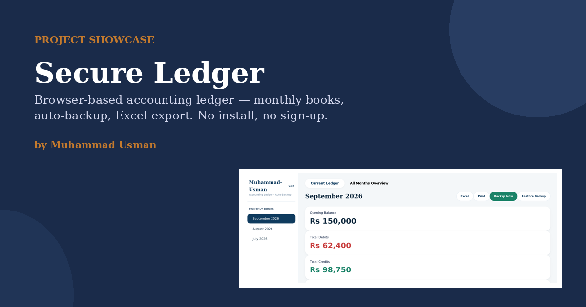
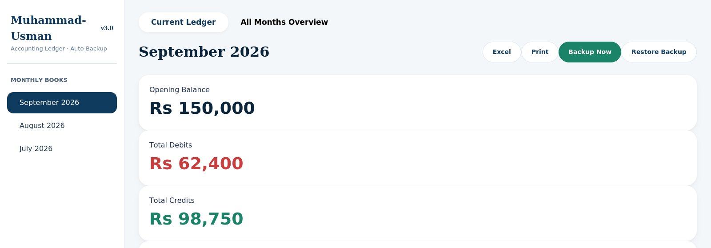
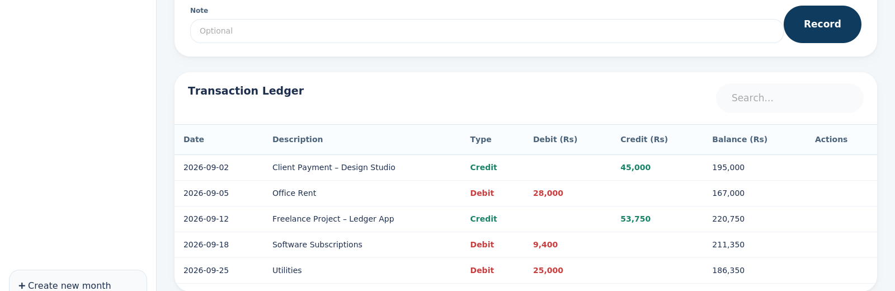

# Secure Ledger

**A complete monthly accounting ledger that runs entirely in your browser.** No install. No sign-up. No server. Your financial data never leaves your computer.

### 👉 [Open the live app](https://Muhammad-Usman-096.github.io/secure-ledger/)



---

## What it does

Small businesses and freelancers often end up tracking money across a messy mix of spreadsheets and notebooks. Secure Ledger keeps a proper set of monthly books, in one place, with nothing to install.

| | |
|---|---|
| **Monthly books** | Create a ledger per month, switch between months instantly, carry opening balances forward. |
| **Debit / Credit entries** | Record transactions with date, description, type, amount and an optional note. |
| **Live stats** | Opening balance, total debits, total credits and closing balance update instantly. |
| **Consolidated overview** | A combined table of every month — opening, debits, credits, closing and net flow. |
| **Search** | Instantly filter the transaction ledger by description. |
| **Excel export** | One click to a clean `.xlsx` file, including a balance-in-words column. |
| **Print** | A clean, print-ready layout for any ledger or the full overview. |
| **Backup & restore** | Manual backup to a `.json` file, plus automatic local autosave and crash recovery. |
| **Edit & delete** | Fix or remove any transaction after it's been recorded. |

## Screenshots

| Ledger overview | Transaction table |
|---|---|
|  |  |

## How to use it

1. **Create a month** — name it (e.g. "September 2026") and it appears in the sidebar.
2. **Set the opening balance** — carried forward from your previous closing balance.
3. **Record transactions** — date, description, debit or credit, amount, optional note.
4. **Check, export or print** — review the live totals, export to Excel, or print the ledger.

Switch to **All Months Overview** any time to see every month's numbers side by side.

## Privacy

- All data is processed and stored locally in your browser (`localStorage`) — nothing is sent to a server.
- Autosave runs automatically so you don't lose work if the tab closes unexpectedly.
- The only network requests are for fonts, icons and the Excel export library, loaded from their standard CDNs.

## Run it locally

No build step. Download the repository and open `index.html` in any modern browser.

```
git clone https://github.com/Muhammad-Usman-096/secure-ledger.git
cd secure-ledger
# then just open index.html
```

## Feedback and support

Found a bug or have an idea? [Open an issue](https://github.com/Muhammad-Usman-096/secure-ledger/issues). Businesses that want a customised or white-label version can reach me on [LinkedIn](https://www.linkedin.com/in/YOUR-LINKEDIN/).

## License

Copyright © 2026 Muhammad Usman. All rights reserved. You are welcome to use the hosted app for your own bookkeeping. See [LICENSE](LICENSE) for details.
